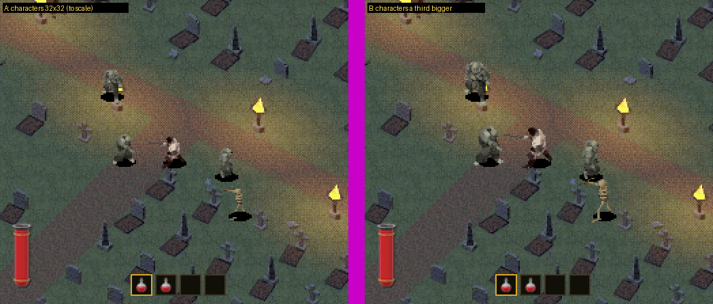
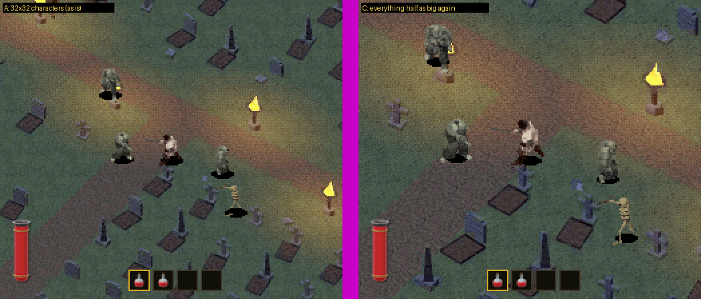

# Anaroch SNES: remake plan

Written 2026-11-27. The graphics and the game code are rebuilt from the ground up for the dual-chip cartridge
(SuperFX 2 + SPC7110). The current graveyard build stays as a reference until the new one passes it.

## Decisions

| Topic | Choice |
|---|---|
| View | Pre-rendered three-quarter view made from the N64 version's 3D areas |
| Speed | 60 FPS; characters are SNES sprites; the SuperFX draws only the big things |
| Rules | The N64 version's, rebuilt in full |
| Sound | The graveyard track's dark ambient style |
| Target | The custom board in `ares_dual` (it will not run on a console or a stock emulator) |

## What is proven

Proven in `ares_dual` by the chip test: SPC7110 unpacking (no wrong bytes), SuperFX drawing from ROM into a
128x128 window about 25 times a second, the sound driver, all together with no dropped frames.

## Step 0 results (2026-11-27)

| Question | Result |
|---|---|
| Can the game's code run while the SuperFX owns the cartridge? | **Yes.** From the SPC7110's window (`$C1:8000`), with the frame and mid-screen interrupts. In ares: 1139 frames, 570 of them worked while the SuperFX held the ROM, 142 checksum passes, none wrong. |
| Does a pre-rendered area fit video memory and palettes? | **Yes**, with moonlight only: the worst screen of the graveyard needs 489 different tiles of the roughly 768 available, with nothing merged. Brazier light baked into the picture would need 957 and does not fit. |
| How big is a land's tile set? | About 4,700 tiles (150 KB) for the graveyard; budget 360 KB a land. |
| How big is an area's map? | As 3x3-tile blocks: about 4 KB for the graveyard, plus a 22 KB block table for the land. |
| Is there CPU time? | **Partly answered.** Fast ROM works from the window and left a third more idle loops (1292 to 1728). The real test is the engine in step 1. |
| Test emulator | Has both chips (`tools/chips.mjs`); `tools/test_chips.mjs` and `tools/test_step0.mjs` pass. |

The picture is a mock-up made from the real tiles and palettes, not a running ROM; the glow in it imitates what the
SNES would draw.

### What changed because of step 0
- **Projection (chosen):** one metre east is 16 right and 8 down; one metre south is 8 left and 8 down. Close to the
  N64 camera, and every metre starts on a tile boundary.
- **Light:** each face has one shade of moonlight. The braziers' glow is a dithered 3-colour layer added by colour
  math, not part of the tiles.
- **Palettes:** the world uses 6 (the HUD and glow layer shares the other two), one of them kept for flames.
- **Background 3** carries the glow. (Changed in step 1: the HUD stays on background 2, and walls, trees and graves
  in front of a character are redrawn as sprites, which needs far fewer tiles than a front layer.)

**Character size (decided):** 32x32, true to the world's scale (A in the picture). The tallest poses, such as the
overhead sword swing, reach about 38 pixels and get a small extra sprite piece instead of being clipped.
Characters a third bigger would not match the graves; everything 1.5 times bigger was tried too (the busiest screen
still fits, at 532 tiles) but shows less than half as much and puts the character art over its budget.

## The world

The N64 version has 128 areas, about 68 x 68 metres on average. As finished pictures they would need about 71 MB;
the SPC7110's data ROM holds 8 MB. So the areas cannot be stored as pictures.

Instead, as Diablo did:
- **Tile sets**, pre-rendered once per kind of land from the N64 models and textures (ground, edges, walls, graves,
  trees, props), packed for the SPC7110.
- **Area maps** that place those pieces, converted from the N64 areas' grids (about 1.1 MB for all of them).
- **The projection above**, so pieces repeat cleanly. The characters are rendered again at exactly that angle.

Data ROM budget (to be checked at each milestone):

| Content | Budget |
|---|---|
| Area maps | 1.2 MB |
| Tile sets | 2.5 MB |
| Characters, monsters, townsfolk, the hero's looks | 3.2 MB |
| Music, instruments, sound effects | 0.8 MB |
| Spare | 0.3 MB |

Pictures like these packed to about 79 % in the test, so little extra room is counted from packing.

## The screen

| Part | Use |
|---|---|
| Background 1 | The whole world picture (6 palettes) |
| Background 2 | The HUD and words |
| Background 3 | The braziers' glow, added by colour math |
| Sprites | Hero, mercenary, up to 8 monsters, loot, arrows, small effects, and what stands in front of a character |
| SuperFX | Drawn into sprite memory: bosses, large spells, scaled and lit effects, 20-30 times a second |

Limits to design around: 128 sprites, at most 8 characters 32 pixels wide on one line, 16 KB of sprite tiles and
about 5 KB of new graphics per frame. A transfer budget decides each frame what is sent first: the hero, then
scrolling, then monsters (their animation steadily at 15 pictures a second), then effects.

## Who does what

| Chip | Job |
|---|---|
| Main CPU | Game rules, input, sprites, scrolling. FastROM if the board allows it |
| SPC7110 | Holds the world, characters and sound data; unpacks graphics straight to video memory |
| SuperFX 2 | Bosses and effects; when idle, heavy sums for the CPU (sorting, pathfinding) |
| Sound chip | 6 voices for music, 2 for effects; instruments loaded per land |

## The rules (from `Anaroch_N64_Sprite`)

Rules and numbers are generated from the N64 version's source files by build scripts, so they are not retyped.

- Hero: life, strength, defence, dexterity, energy; levels to 99; stamina; resistances; the nine weapon families.
- Combat: the damage, crit, block, evade and knockback formulas; elements; bleeding, chill and stun.
- 36 skills in their trees.
- Items: 120 bases, qualities, affixes, uniques; bag, seven worn slots, belt, potions, scrolls, keys, chests.
- Monsters: their senses, calling each other, archers and casters, champions, bosses, the Gildling and its rift.
- World: seven acts, 128 areas, towns and houses, people, 16 quests with their choices, waypoints, town portals.
- Mercenaries, saves in several slots, New Game+.

Controls: B attack, Y skill, A talk and pick up, X drink, L and R change belt slot and skill (hold R for skills),
Select character and bag, Start pause. Bag and windows are cursor menus made for a pad.

Saving needs battery memory: it is added to the board.

## Order of work

Each step ends in a ROM you can run, and the next starts after you have seen it.

**0. Foundations.** Done, see the results above.

**1. The graveyard, finished look.** Done, approved 2026-11-27.
- Scrolling world with things in front of and behind the characters, new hero and monster pictures.
- Walking, fighting, loot, HUD at 60 FPS with 8 monsters.
- Its music and the first sound effects.
- *Done when:* you approve how it looks, sounds and plays. This sets the standard for everything after.

**2. The core of the RPG**, in four parts
- *2a (built 2026-11-27):* stats, items, bag and equipment, belt, drops. Also the studio's splash, as the N64's.
- *2b:* skills and their trees, stamina, the skill button.
- *2c:* Stormreach Keep with its people and shop, gates between areas.
- *2d:* saving.

**3. Act I complete**
- All its areas, quests, the mercenary, waypoints, the act's boss drawn by the SuperFX.

**4. Acts II to VII**
- A tile set, monsters, music and boss per land, through the same build scripts.

**5. The whole game**
- Title, story scenes as still pictures, endings, New Game+, balance, a full play-through.

Map exits keep one rule everywhere: leaving by the west enters the next area from its east side, facing west.

## Risks

| Risk | If it happens |
|---|---|
| Objects in front of characters need too many extra tiles | Keep only tall things (walls, crypts, trees) in the front layer |
| CPU time runs out | Monster thinking at 30 Hz, FastROM, sorting and pathfinding on the SuperFX |
| 8 MB is not enough | Fewer hero looks and animation pictures first, then tile set variety |
| Only `ares_dual` runs it | Accepted for this experiment; keep the board file and notes in the repository |
